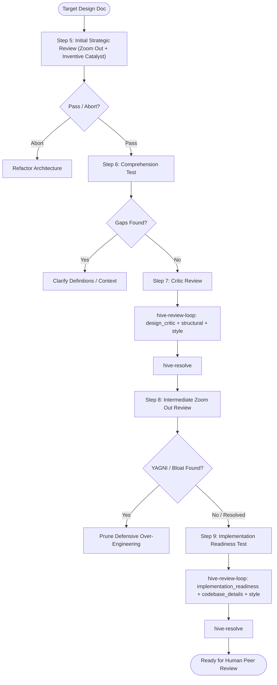

# Hivework Hivework Review Protocol & Resolution Engine

*   **Authors:** Hivework
*   **Status:** Current
*   **Date:** 2026-11-13

--------------------------------------------------------------------------------

## Overview

The **Hivework Review Protocol** is the verification engine of the Elephant &
Hivework Reviewer Model. It stress-tests draft design specifications using
isolated, zero-context AI subagents ("Hivework Reviewer") evaluating the document against
strict qualitative rubrics.

This document specifies:

1.  The multi-stage review pipeline (`/hive-review`).
2.  The review orchestration driver (`hive-review-loop`).
3.  The complete catalog of specialized reviewer personas.
4.  The mapping to document standards and evaluation rubrics
    (`resources/document_standards/`).
5.  The interactive resolution engine (`hive-resolve`).

## The Problem

Self-review by the authoring LLM suffers from severe confirmation bias. When the
same context window drafts and reviews a plan:

1.  **Blind Spots Persist**: The model assumes the context it holds in memory is
    obvious from the text, overlooking unstated assumptions and undefined terms.
2.  **Hallucination Masking**: Invalid API assumptions made during discussion go
    untested against actual source code.
3.  **Premature Implementation Approval**: Implementation plans lacking concrete
    file paths or test strategies are rubber-stamped without scrutiny.

The Hivework Reviewers model mitigates this by spawning fresh, stateless subagents that
read only the target document and explicitly referenced source files.

## Review Pipeline Architecture (`/hive-review`)

The full review pipeline executes five sequential evaluation phases:

### Stage Breakdown

1.  **Step 5: Initial Strategic Review (Altitude & Contradiction Check)**:
    *   *Target*: Full Document.
    *   *Personas*: [`zoom_out`](../../agents/hive-zoom-out.md) (Skeptical Architect), [`inventive_catalyst`](../../agents/hive-inventive-catalyst.md) (Inventive Catalyst).
    *   *Standards*: `zoom-out-standard.md` (for `zoom_out`), Inlined Pattern Catalog (for `inventive_catalyst`).
    *   *Focus*: Validates problem framing, rejects speculative features
        (YAGNI), identifies technical contradictions, suggests pattern resolutions,
        and verifies reuse of existing infrastructure before investing in
        detailed review passes.
2.  **Step 6: Comprehension Test (Self-Containment Check)**:
    *   *Target*: `FeatureRange` vs `DetailedRange`.
    *   *Persona*: [`comprehension`](../../agents/hive-comprehension.md) (Naive Reader).
    *   *Standard*: Baseline Self-Containment.
    *   *Focus*: Reads the document with zero prior context. Identifies missing
        prerequisites, unexplained acronyms, and conceptual gaps.
3.  **Step 7: Critic Review (Antagonistic Stress-Test)**:
    *   *Target*: `FeatureRange` (High-Level Architecture).
    *   *Personas*: [`design_critic`](../../agents/hive-design-critic.md),
        [`structural`](../../agents/hive-structural.md), [`style`](../../agents/hive-style.md).
    *   *Standards*: `feature-spec-standard.md`, `heilmeier-standard.md`.
    *   *Focus*: Probes single points of failure (SPOFs), scaling limits,
        failure modes, and edge cases.
4.  **Step 8: Intermediate Zoom Out Review (Post-Critic Pruning)**:
    *   *Target*: Full Document.
    *   *Persona*: [`zoom_out`](../../agents/hive-zoom-out.md) (Skeptical Architect).
    *   *Standard*: `zoom-out-standard.md`.
    *   *Focus*: Incremental audit focusing on additions, modifications, and
        defensive mitigations introduced during Comprehension and Critic
        reviews. Purges speculative complexity and YAGNI elements before task
        planning, while avoiding re-flagging decisions accepted in Step 5.
5.  **Step 9: Implementation Readiness Test (Actionability Check)**:
    *   *Target*: `DetailedRange` (`## Detailed Implementation Plan`).
    *   *Personas*: [`implementation_readiness`](../../agents/hive-implementation-readiness.md),
        [`codebase_details`](../../agents/hive-codebase-details.md), [`style`](../../agents/hive-style.md).
    *   *Standards*: `implementation-readiness-standard.md`, `re-implementation-standard.md`.
    *   *Focus*: Verifies that every file touched is listed as an explicit
        repository-relative write boundary with rationale, API signatures match
        current codebase reality, and step-by-step test plans exist.

--------------------------------------------------------------------------------

## Reviewer Persona Catalog

All reviewer persona prompts reside under [`agents/`](../../agents/):

| Persona File | Role Title | Core Responsibilities |
| :----------- | :--------- | :-------------------- |
| [`agents/hive-zoom-out.md`](../../agents/hive-zoom-out.md) | Skeptical Architect | Audits for over-engineering, YAGNI, and unneeded complexity. Searches codebase for existing utilities to prevent reinvention. |
| [`agents/hive-comprehension.md`](../../agents/hive-comprehension.md) | Naive Reader | Assumes no prior knowledge. Identifies undefined jargon, assumed system context, and missing architectural diagrams. |
| [`agents/hive-design-critic.md`](../../agents/hive-design-critic.md) | Analytical Design Critic | Evaluates system reliability, scale limits, operational risks, failure recovery, and trade-off justification. |
| [`agents/hive-implementation-readiness.md`](../../agents/hive-implementation-readiness.md) | Tech Lead Auditor | Ensures implementation plans contain unambiguous, deterministic instructions, complete file lists, and verification steps. |
| [`agents/hive-codebase-details.md`](../../agents/hive-codebase-details.md) | Codebase Auditor | Cross-references referenced paths, classes, and function signatures against live source code to prevent drift and hallucinated APIs. |
| [`agents/hive-structural.md`](../../agents/hive-structural.md) | Layout Validator | Enforces standard heading hierarchy, table formatting, and document template conformance. |
| [`agents/hive-style.md`](../../agents/hive-style.md) | Technical Copy Editor | Strips conversational filler, enforces factual, objective tone, calibrates defensive caveats (`DROP` / `CALIBRATE` / `RELOCATE` / `KEEP`), and ensures adherence to concise technical writing standards. |
| [`agents/hive-inventive-catalyst.md`](../../agents/hive-inventive-catalyst.md) | Inventive Catalyst | Applies TRIZ principles to identify technical contradictions, false compromises, and pattern-based resolutions. |
| [`agents/hive-synthesizer.md`](../../agents/hive-synthesizer.md) | Review Synthesizer | Spawns reviewers in parallel, deduplicates findings, formats file links, and writes consolidated report artifacts. |

--------------------------------------------------------------------------------

## Document Standards & Rubrics (`resources/document_standards/`)

Reviewers evaluate drafts against the versioned standards listed in the
[shared runtime resources](../../resources/README.md). Read the actual standard
for its requirements. The stage breakdown above maps each review to its
standards; it does not replace those rubrics.

--------------------------------------------------------------------------------

## The Interactive Resolution Engine (`hive-resolve`)

When Hivework reviewers complete their audit, the **Elephant Resolution Engine**
ingests the flat findings list and manages interactive triage.

### 1. Evaluation & Categorization

For each finding, the Elephant determines:

*   **`PROPOSE FIX`**: The critique is valid. Generates exact replacement
    strings or structural edits.
*   **`CONTEST`**: The critique is invalid or based on a misunderstanding. Cites
    concrete codebase evidence defending the current text.
*   **`ESCALATE`**: The critique is invalid, but only knowledge outside the
    reviewed files refutes it. The user decides. The Elephant does not add
    context that only a zero-context reviewer needs.
*   **`DECLINE`**: The finding is a Nit. It is recorded and not fixed.

A contest must cite evidence the reviewer could read. Comprehension gaps cannot
be contested, and severities cannot be changed without a contest.

### 2. User Triage Modes

The engineer reviews `hivework_review_report.md` via four interaction modes:

*   **Auto Accept**: Batch-applies all `PROPOSE FIX` suggestions and skips
    `CONTEST` items.
*   **Interactive Breakdown**: Sequential, item-by-item chat walkthrough with
    detailed explanations and overrule capabilities.
*   **Artifact Comments**: Inline comments on the artifact parsed and applied by
    the Elephant. (Recommended)
*   **Wildcard Requests**: Pauses the review to answer ad-hoc questions or run
    exploratory commands before resuming triage.

### 3. Iteration & Checkpoint Gating

After fixes are applied, the loop presents a mandatory checkpoint asking the
user whether to run another review pass or complete the workflow. Findings that
were contested or recorded without a fix stay settled across rounds. A fixed
finding re-opens if a later review raises it again. A round is clean when its
review results contain no unsettled Blocker or Major finding. The process
concludes after two consecutive clean rounds, or when the engineer halts the
loop. At 5 rounds, or when a new finding would be resolved by reverting an
earlier fix, the loop asks the engineer to accept, continue, or return to
drafting.

## Implementation Files

| File Path | Type | Purpose & Reason for Existence |
| :-------- | :--- | :----------------------------- |
| `skills/hive-review/SKILL.md` | Skill Definition | Entry point orchestrating the multi-stage review pipeline (Zoom Out $\rightarrow$ Comprehension $\rightarrow$ Critic $\rightarrow$ Intermediate Zoom Out $\rightarrow$ Readiness). |
| `skills/hive-review/TEST.md` | Unit Tests | Verification test scenarios testing `/hive-review` multi-stage flow and checkpoint gating. |
| `skills/hive-review/test_scenarios.yaml` | Evaluation Benchmark | Benchmark test suite evaluating model review precision and recall. |
| `skills/hive-review-loop/SKILL.md` | Skill Definition | Central review driver managing asynchronous subagent spawning and findings collection. |
| `skills/hive-review-loop/TEST.md` | Unit Tests | Verification test scenarios testing hivework reviewer review loop dispatch. |
| `skills/hive-review-loop/test_scenarios.yaml` | Evaluation Benchmark | Benchmark test suite evaluating hivework reviewer review loop dispatch. |
| `skills/hive-resolve/SKILL.md` | Skill Definition | Elephant resolution engine managing `CONTEST` vs `PROPOSE FIX` triage and automated fixes. |
| `skills/hive-resolve/TEST.md` | Unit Tests | Verification test scenarios validating the finding categorization and resolution loop. |
| `skills/hive-resolve/test_scenarios.yaml` | Evaluation Benchmark | Benchmark test suite evaluating model resolution and fix proposal accuracy. |
| `agents/*.md` | Persona Prompts | System prompt instructions for all 8 Hivework reviewers and the Synthesizer. |
| `resources/document_standards/*.md` | Document Standards | Evaluation rubrics and standards for feature specs, implementation readiness, and simplicity. |

## References
*   DARPA, [The Heilmeier Catechism](https://www.darpa.mil/about/heilmeier-catechism).
